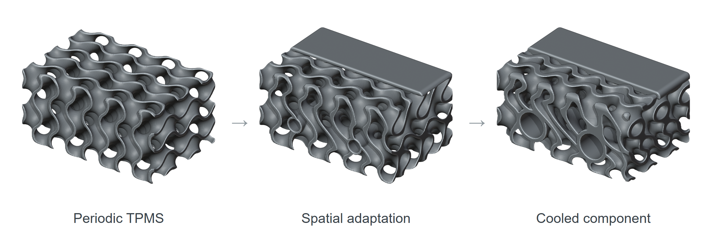
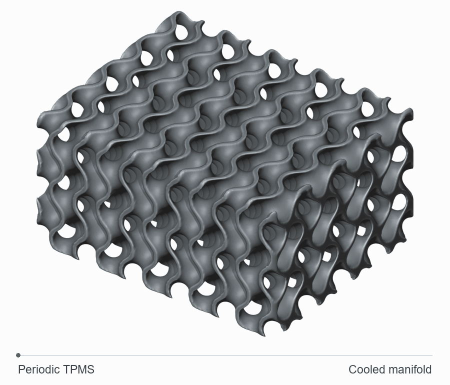
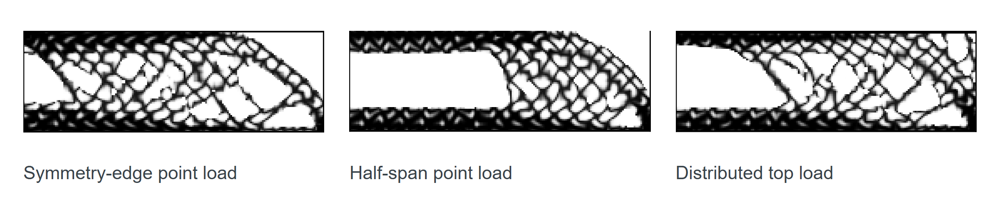
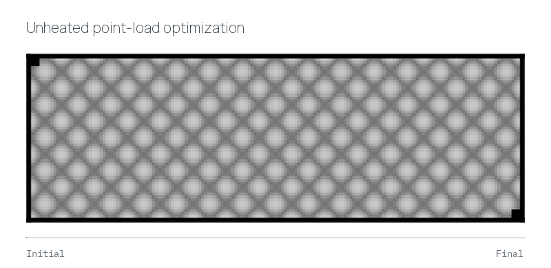
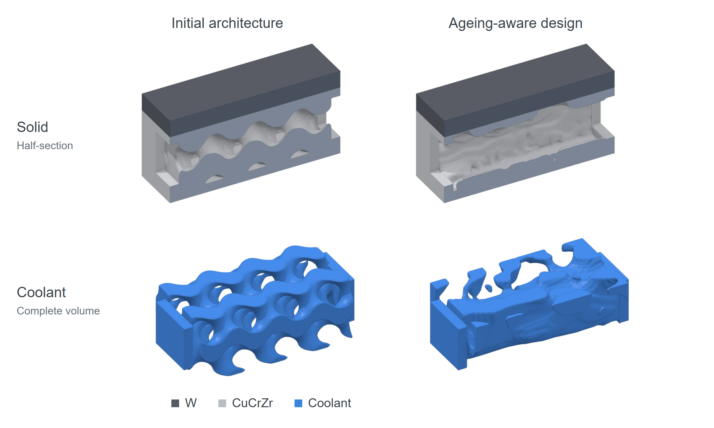
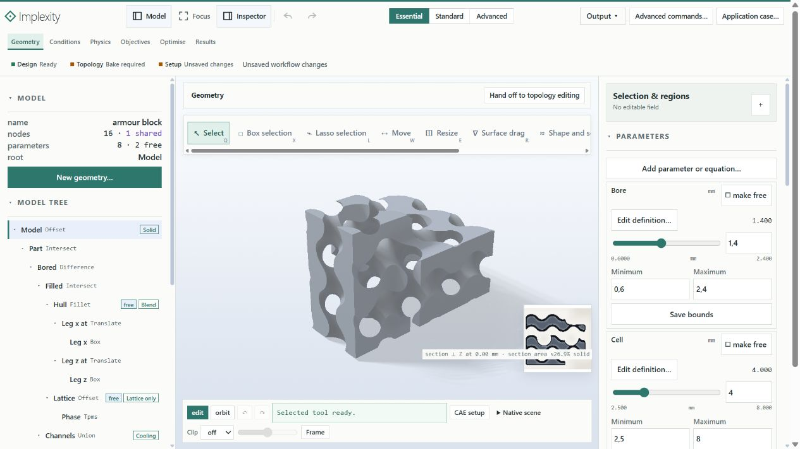
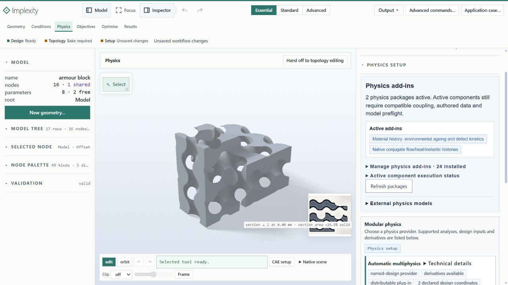

# Implexity

Implexity is a Rust framework for topology optimization. It uses coupled physics and material ageing to guide changes to differentiable implicit geometry.

<picture>
  <source media="(max-width: 600px)" srcset="docs/assets/geometry-mobile.png">
  
</picture>

*Epoch-wise variation of periodic TPMS structures towards application-adapted structures.*

<details>
<summary>Geometry morph</summary>



</details>

## Formulation

A design can be optimized across any number of compatible physics models at once, which includes arbitrary multi-physical couplings and, in particular, the effects of geometry- and material-dependent ageing.

Locally emerging fields that result from local physical conditions allow to control the cell shape, the cell spacing, the wall thickness, the topology, and the material distribution. Through automatic differentiation and adjoints, these controls are linked to the specific physical response and the dynamically varying ageing history.

[Method](docs/method.md) · [Research notes](docs/research.md)

## Research

### Differentiable scaffold geometries

[Direct gradient-based topology optimization of differentiable scaffold geometries under physicochemical ageing](https://papers.ssrn.com/sol3/papers.cfm?abstract_id=7350458)

The scaffold study optimizes the lattice geometry under thermoelastic loading, with physicochemical ageing and surrogate models of tissue deposition and resorption.

<picture>
  <source media="(max-width: 600px)" srcset="docs/assets/scaffold-study-mobile.png">
  
</picture>

*Unheated designs under different loading conditions.*

<details>
<summary>Optimization sequence</summary>



</details>

### Liquid-cooled divertor architectures

[Lifecycle-aware topology optimization of liquid-cooled fusion reactor divertors](https://papers.ssrn.com/sol3/papers.cfm?abstract_id=7596080)

The divertor study couples the heat transfer, the coolant flow, and the mechanical response to design tungsten–CuCrZr structures that account for creep and helium retention.

<picture>
  <source media="(max-width: 600px)" srcset="docs/assets/divertor-study-mobile.png">
  
</picture>

## Getting started

Build Implexity with the repository’s [Rust toolchain](rust-toolchain.toml).

```sh
git clone https://github.com/SamuelSchlicht/Implexity.git
cd Implexity
cargo build --release --locked -p implexity-cli --bin implexity --no-default-features
./target/release/implexity model examples --copy models
```

[Installation and usage](docs/getting-started.md)

## Graphical workbench

```sh
./target/release/implexity serve --workspace ./workspace
```

Open the [local workbench](http://127.0.0.1:8765) to build the geometry, set up the physics and the ageing models, and follow an optimization run.



| Workspace | Use |
| :--- | :--- |
| Geometry | Create or import the geometry; edit the parameters, the fields, and the design bounds. |
| Conditions | Select the regions and assign the loads and the boundary conditions. |
| Physics | Choose the physics, the materials, the couplings, and the ageing laws. |
| Objectives | Set the responses to optimize and the limits to satisfy. |
| Optimise | Check the setup, then run, pause, or resume the optimization. |
| Results | Review the fields, the histories, and the sensitivities from the run. |

<details>
<summary>Physics and ageing setup</summary>



In **Manage physics add-ins**, choose the models you need. Open each provider’s setup to enter the material data and the history data.

</details>

Export the meshes, the images, and the sections from **Output**. [GUI walkthrough](docs/gui.md)

## Repository structure

| Area | Modules |
| :--- | :--- |
| Geometry | [Implicit kernel](crates/implexity-geometry) · [Lattice representation](crates/implexity-geometry/src/lattice) · [Example models](crates/implexity-geometry/data/models) |
| Derivatives and numerics | [Automatic differentiation](crates/implexity-ad) · [Linear algebra](crates/implexity-linalg) · [Solvers](crates/implexity-solve) |
| Physical models | [Solids](crates/implexity-physics-solid) · [CFD](crates/implexity-physics-cfd) · [Thermofluids](crates/implexity-physics-thermofluid) · [Fields](crates/implexity-physics-fields) |
| Optimization and execution | [Optimization](crates/implexity-optim) · [Physics orchestration](crates/implexity-core/src/orchestration) · [Runtime](crates/implexity-runtime) · [Jobs](crates/implexity-jobs) |
| Inspection and export | [Meshing](crates/implexity-mesh) · [Rendering](crates/implexity-render) · [Browser viewer](viewer) |
| Interfaces | [CLI](crates/implexity-cli) · [Server](crates/implexity-server) · [MCP bridge](crates/implexity-mcp) · [Desktop workbench](crates/implexity-desktop) |

## Attribution and license

Samuel Schlicht · Metaplexis Ingenieurgesellschaft mbH

[Papers](#research) · [BibTeX](docs/references.bib) · [Apache License](LICENSE) · [Disclaimer](DISCLAIMER.md) · [Third-party notices](THIRD_PARTY_NOTICES.md)
